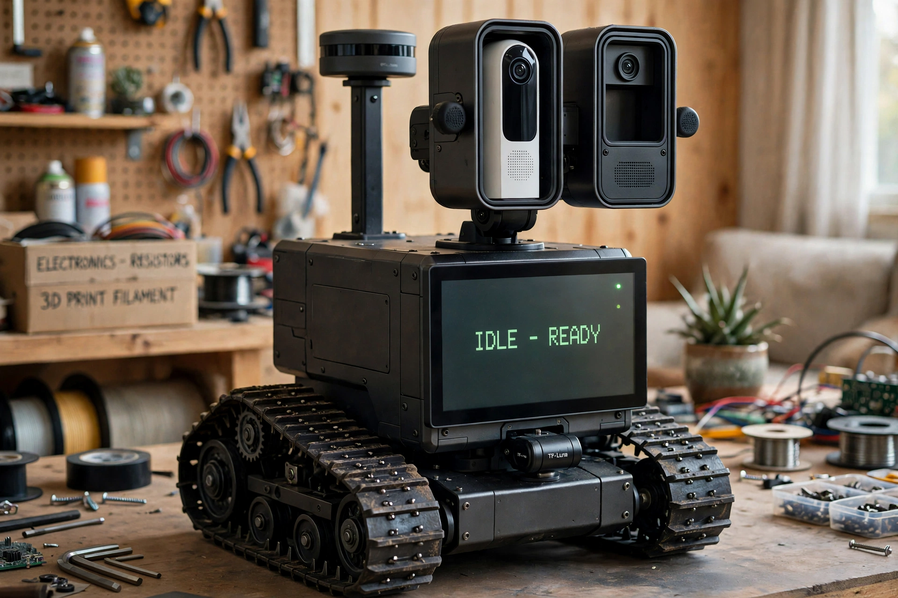

# Wall-E

A working replica of Pixar's Wall-E — tracked drive base, binocular head, and
(under evaluation) an articulated arm — that drives and navigates
autonomously. **Wally** (Muse) is part of the robot: conversation, voice,
and high-level decisions run through Muse over the network, while onboard
computers handle motors, sensors, power, and local navigation.

*The locked target render (2026-11-03). Two known drifts vs the drawings:
the lidar scan plane in the render sits level with the pod tops (the real
pedestal holds it above the head at full upward tilt), and the right pod's
lower volume houses the ESP32-S3 head hub in the design.*

## Principles

- **Functional first, printing later.** Voice bench, rolling chassis, and a
  mock body before any 3D-printed shell; the shell is an original design
  from requirements, with Pixar fidelity as a guideline.
- **Safety is architectural.** A Pico co-processor owns motor power and the
  watchdog, so no Linux or network failure can leave the robot driving.
- **Measured state over assumed state.** Power rails, checkpoints, and dock
  status are sensed and reported, never merely commanded.

## Architecture

| Component | Role |
|---|---|
| Wally / Muse (cloud) | Conversation, personality, high-level decisions, over WiFi |
| Raspberry Pi 5 | ROS 2 + Nav2, sensor fusion, wake word, STT/TTS, Home Assistant link, chest-display web server |
| Raspberry Pi (display unit, TBD) | Chest display only: fullscreen kiosk browser |
| Raspberry Pi Pico | Motor/encoder co-processor **and** power sequencer (watchdog, rail enables, thermal monitoring) |
| ESP32-S3-WROOM | ESPHome sensor/servo hub |
| Raspberry Pi Pico 2 W, Pi Zero | Unassigned utility / satellite duties |

## Status — 2026-11-06

- **Voice bench:** working. openWakeWord loop answers through the locked
  Wall-E voice chain; runs as the `wake-listen.service` systemd user
  service. Xbox controller paired for teleop, with an evdev voice trigger
  running as `controller-voice.service`.
- **Chassis:** Hiwonder Tank Car Chassis Kit (encoder motors) — out for
  delivery, ETA 2026-11-07. Cytron MDD10A driver in hand, bench test next.
- **Power:** Pico sequencer v1 proven on the bench (heartbeat-gated motor
  rail, latched faults); MCP9808 thermal sensor live in the sequencer.
  Motor-rail and charge-path switches (Pololu #2815 / #5421) ordered
  2026-11-05. Pico carrier PCB ("Wall-E Monitor") is in layout.
- **Arm exploration (not yet plan of record):** a Pavv 6DOF arm kit was
  bought used to test a no-box concept — the arm centre-mounted on the
  chassis deck, batteries/electronics in a low tray, possibly replacing
  the separate head pan/tilt kit. It arrives 2026-11-08 and will be
  bench-tested from the ESP32-S3 (see `firmware/esp32-arm-test/`).

Full detail: [docs/wall-e-robot-plan.md](docs/wall-e-robot-plan.md)

## Repo layout

- `docs/` — build plan, weight budget, charging-dock build page,
  voice-client parts spec, target render
- `firmware/esp32-arm-test/` — ESP32-S3 bench sketch for the 6DOF arm
- `firmware/pico-sequencer/` — Pico power-sequencer / motor firmware
  (placeholder: the live code currently resides on the Pico itself)
- `hardware/pico-carrier/` — KiCad schematic for the Pico carrier board
- `software/pi-voice-client/` — Pi-side voice scripts (placeholder: the
  live scripts currently reside on the Pi)

## Note on the public copy of the plan

`docs/wall-e-robot-plan.md` is the build plan with personal details
trimmed for a public repo (the Life360 member list in the "Where is
everyone?" section). Everything technical is intact.
