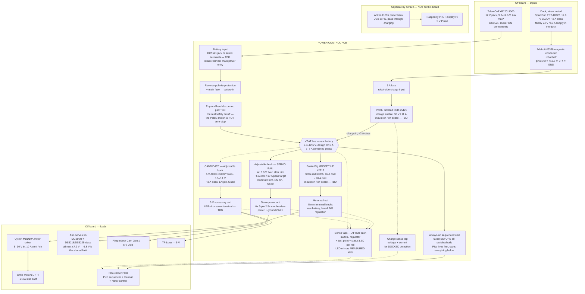
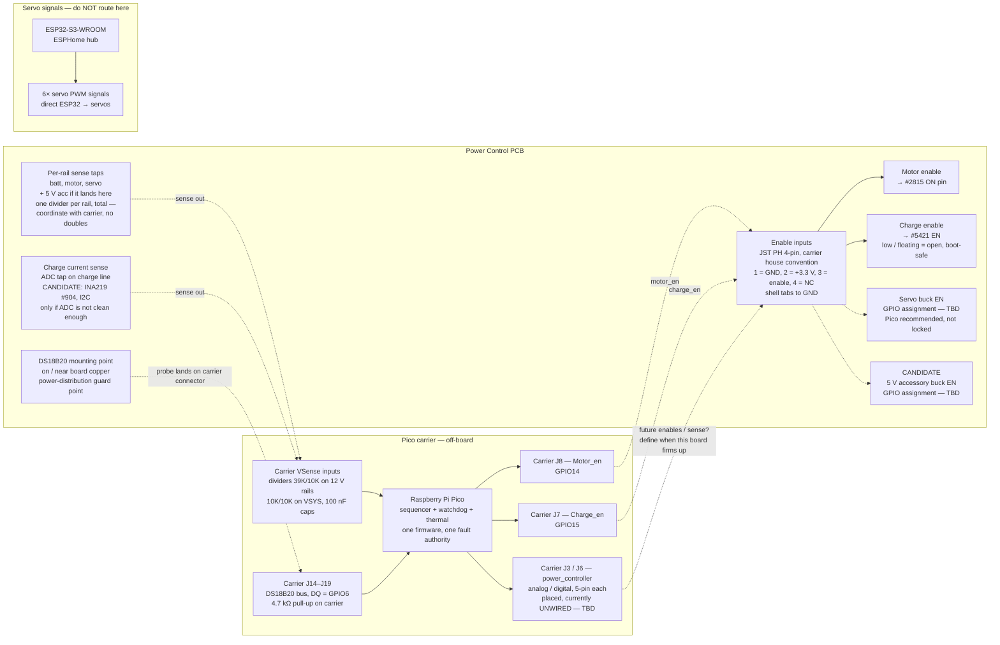

# Wall-E — Power Control PCB — Block Diagram

_Created 2026-11-17 (Wally), from `power-control-pcb-notes.md` (2026-11-14), the system block diagram (2026-11-15), the charging dock build page, and the carrier netlist as verified 2026-11-16._

**What this board is:** power distribution and regulation only.
**What it is not:** logic, motor drive, or servo signals. The Pico carrier does logic / motors / sensing, the MDD10A drives the motors, and the ESP32-S3 originates all servo PWM. No motor current and no servo signal crosses this board — only power, enables, and sense taps.

> **Rail scope is still deliberately undecided** (Jim, 2026-11-14: “lets see where it all lands”).
> In the diagrams below, solid blocks are the locked core, dashed / `[CANDIDATE]` blocks are rails that *can* live here but have not been locked to this board. Nothing dashed is a decision.

**Reading the diagrams:** solid arrows `──►` are power. Dashed arrows `┄►` are control / sensing (low current). Voltages, currents, and part numbers are the design values from the notes — where a part is TBD, the block says TBD.

> **Update 2026-11-18 — servo distribution moved off this board.** Jim added a third custom board, the **servo hub board** (ESP32-S3 socketed, 6× servo connectors, its own logic regulator, INA219 servo current sense in this board's circuit, EN input from the Pico). The servo blocks below (SERVOBUCK output → 6× headers on this board, the servo row of the rail table, interface #4) are **superseded**: this board's servo involvement is now only the J5 VBAT tap feeding the buck; the buck's 6.8 V output lands on the servo hub board. Current state lives in the build plan's "Servo hub board" section and the system block diagram. This document also predates the combined 5-pin power_en connector, the on-board INA219s, and the PD top-up — treat it as the 2026-11-17 snapshot, not current truth.

---

## 1. Power path — main block diagram



\* **Pack caveat carried in the design:** YABO's spec lists both “12 V / 6 A max” and “max continuous charge/discharge 3 A”. Treat 6 A as peak until the combined motors + arm stall test proves otherwise. The #2815 is not the limiter (16 A continuous).

**Charge-path note:** the TalentCell's single DC5521 port is both its output and its charge input, and its rocker must be ON to charge — so the rocker stays ON permanently and *all* switching is downstream. Charging joins the battery node through the fuse + SSR above; the SSR, not the rocker, is what gates charge. When the SSR is open there is no charge current even if the robot is mechanically docked — that is correct behaviour, not a fault.

**Why the sequencer feed is drawn first:** the Pico is the always-on safety root. Its feed is taken before the motor switch, the servo buck, and every other switched rail, so no rail can be live before the Pico is alive to own it — and a fault in any switched rail cannot take the Pico down with it.

---

## 2. Control & sensing — signal block diagram

Power is only half this board. Every rail must be **killable by the Pico** and **measurable by the Pico** — a regulator the sequencer can't kill is a fault-path hole, and a rail with no read-back is assumed state, not measured state.



### Control / sense contract

| Signal | Source → destination | State / rule |
|---|---|---|
| `motor_en` | Pico GPIO14, carrier J8 → #2815 ON pin | High = motor rail live. Slide switch on the #2815 stays OFF so the Pico owns the state (slide ON is a manual override, not the e-stop) |
| `charge_en` | Pico GPIO15, carrier J7 → #5421 EN (VIN ← +3.3 V permanently, GND common) | Low / floating = open. Nothing charges unless the sequencer closes it |
| `servo_en` | Pico (recommended) → servo buck EN | GPIO **TBD**. Pico is recommended so there is one fault authority — thermal policy already cuts guarded rails from the Pico. Not locked |
| `acc_en` | Pico → 5 V accessory buck EN | Only if that rail lands here. GPIO **TBD** |
| Rail sense ×N | Tap **after** each switch / regulator → carrier VSense → Pico ADC | One tap per rail. batt_rail and motor_rail taps already exist in the carrier design — this board adds servo (and 5 V acc, if here). Never two dividers on one rail, never none |
| Charge sense | Charge line → Pico ADC (or INA219 #904 on I2C, candidate) | Must support **DOCKED = voltage present AND >100 mA sustained ~2 s**, and charging vs full by current level |
| Board temp | DS18B20 probe at power-distribution point → carrier J14–J19 bus (GPIO6) | **Motor-side guard:** hot reading drops the motor rail. Battery / charge-connector probes (on the same bus, off this board) open the charge path instead |

### Sequence this board must obey (Pico-owned, binding)

```
Battery in → Pico live (sequencer feed) → Pi rail up → Pi heartbeat
HB <counter> every 250 ms, 1000 ms watchdog → only then motor rail on.
Shutdown / fault reverses it: motor rail first, then the rest.
60 s boot wait is not a fault. A latched fault clears only by Pico reset.
```

Thermal policy, as it lands on this board: battery + charge-connector hot → charge path opens · MDD10A + motors + **power-distribution (this board)** hot → motor rail off · bay / body air hot → warn only.

---

## 3. Rails on this board

| Rail | In → out | Regulation | Switch / enable | Load | Status |
|---|---|---|---|---|---|
| **Servo** | VBAT → 6.8 V | Adjustable buck, trim under load, then lock / mark the pot (fixed divider in a later rev) | Buck EN ← Pico, GPIO TBD | 6 servos, ~2.5 A stall each; 6 A cont / 10 A peak design target | **Headline rail — locked voltage, regulator implementation open** (module vs designed-in IC, see TBD) |
| **Motor** | VBAT → raw 9.0–12.6 V | **None — do not regulate** (MDD10A takes 5–30 V, torque wants raw voltage) | #2815 ← GPIO14 | MDD10A → 2 drive motors | Locked path; #2815 mount on/off board TBD |
| **Charge** | Dock 12.6 V → pack | None (CC/CV is in the dock's PRT-18722) | #5421 SSR ← GPIO15 | TalentCell charge input, ~2 A class, 3 A fuses both sides of the magnetic connector | Locked path |
| **Sequencer feed** | VBAT → carrier / Pico | Per carrier design (VSYS OR-ing on the carrier) | Always on — before all switched rails | Pico only, low current | Locked principle; exact tap / connector TBD at layout |
| **5 V accessory** | VBAT → 5.0–5.1 V | Adjustable buck, ~3 A class | Buck EN ← Pico, GPIO TBD | Ring cam (5 V USB), TF-Luna | **CANDIDATE — on/off this board undecided** |
| **Pi 5 V** | Anker A1695 → Pi 5 | USB-C PD, pass-through | Anker / sequencer world, off-board | Pi 5 (5 V / 5 A appetite), display Pi (route open) | **Off this board by default** — moving it here is a deliberate redesign |
| **3.3 V / sensors** | → 3.3 V fixed | Fixed regulator | — | Low-current logic / sensors | **CANDIDATE — may stay on the carrier. Decide once, don't duplicate silently** |

---

## 4. Board-edge interface list

Every connector that crosses this board's boundary. Pinouts are the carrier's verified house convention where one exists.

| # | Interface | Connector | Pins / values | Notes |
|---|---|---|---|---|
| 1 | Battery in/out | DC5521 barrel, 5.5 × 2.1 mm, centre + | 9.0–12.6 V, 6 A design | Panel jack vs cut lead into screw terminals — TBD. Strain-relieve it |
| 2 | Charge in (robot half) | Adafruit #5358 magnetic, right-angle 4-contact | 1+2 = +12.6 V, 3+4 = GND | Never run charge current on a single pin — no per-pin rating is published |
| 3 | Motor rail out | 5 mm terminal blocks (the #2815's included blocks) | Raw VBAT | To MDD10A screw terminals. Motor current never crosses a signal header |
| 4 | Servo power out ×6 | 3-pin 2.54 mm servo headers (JR/Futaba pattern) | Power + ground only | **No signal pins from this board** — signals come direct from the ESP32-S3 |
| 5 | 5 V accessory out | USB-A or screw terminal — TBD | 5.0–5.1 V, ~3 A class | Candidate rail. Ring cam uses its supplied USB cable; TF-Luna its pigtail |
| 6 | Sequencer feed out | TBD at layout | Always-on, low current | To carrier / Pico; taken before all switched rails |
| 7 | Enables in | JST PH 4-pin ×N | 1 GND, 2 +3.3 V, 3 enable, 4 NC; shell to GND | Same convention as carrier J7/J8 so cables are interchangeable. Any new regulator EN follows it |
| 8 | Sense out | Compatible with carrier VSense | One tap per rail, after its switch / regulator | Divider ownership coordinated with the carrier — see §2 |
| 9 | Temp guard | Probe mount on board | DS18B20 → carrier J14–J19 | Board provides the mounting point that reads real copper temp; the connector lives on the carrier |
| 10 | Charge-current sense (candidate) | Adafruit INA219 #904, I2C | — | Only if Pico ADC read-back isn't clean enough for the DOCKED test |

**Grounding:** one common ground with carrier / sequencer / ESP32 hub, star back to battery negative. No servo or motor current through logic ground paths.

**Layout rules that shape the blocks above:** high-current paths in copper pours / wide traces, 2 oz copper preferred, screw terminals rated for the current · test point per rail · status LED per rail mirroring *measured* state · regulator heatsinking on copper, kept away from the MCP9808 bay-air sensor · multi-turn cermet trim pots, set under load · per-rail fuse or polyfuse, reverse-polarity protection on battery and charger inputs.

---

## 5. Open / TBD — deliberately not drawn as decided

- **Rail scope** — which candidate rails (5 V accessory, 3.3 V) actually live on this board. Servo rail is the headline; the rest lands where the build lands.
- **Hard disconnect part** — TBD. This board is its natural home, and it is load-bearing: with the pack rocker ON permanently, this disconnect is the safety cutoff.
- **#2815 and #5421 mounting** — on this PCB or off-board beside it, TBD at layout.
- **Battery jack style** — panel DC5521 jack vs cut lead into screw terminals.
- **Servo / accessory buck implementation** — adjustable modules soldered on (XL4016-class) for rev 1 vs converter ICs designed in. The bench proof of the 6.8 V rail (adjustable buck module, rest / hold / stall, watch for dip below ~6.5 V) is still an open bench step — no bench buck part has been chosen or ordered as of 2026-11-17.
- **Servo-rail enable authority + GPIOs** — Pico recommended (one fault authority), not locked; no GPIO assigned yet for `servo_en` / `acc_en`.
- **Carrier J3 / J6** — the 5-pin `power_controller_analog` / `power_controller_digital` connectors are the natural interconnect for this board, but they are currently unwired with no no-connect markers. Define their pinouts when this board firms up, or NC-mark them.
- **Board outline** — TBD once rail scope settles; must fit the low tray alongside the pack (138 × 80 mm, 39 mm thick).

---

_Sources: `power-control-pcb-notes.md`, `wall-e-system-block-diagram.md` §2, `charging-dock-build.md`, carrier netlist verified 2026-11-16 (in `wall-e-robot-plan.md`). Corrections applied vs older notes: dock charger is SparkFun **PRT-18722** (not COM-18335); servo rail is **6.8 V** (not 7.4 V — label-confirmed 2026-11-16); #2815 rating is **16 A continuous** (the 6 A figure is only its 55 °C still-air heating point)._
