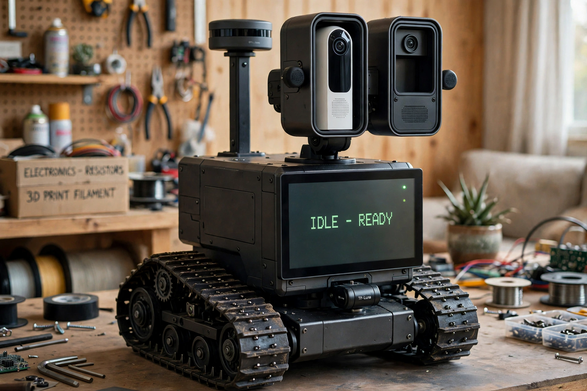

# Wall-E Replica Robot — Build Plan

_Last updated: 2026-11-03. Goal: a working Wall-E-style robot — tracked drive base, articulated arms and binocular head, driving and navigating autonomously. Wally (Muse) is part of the robot: conversation, voice, and high-level decisions run through Muse over the network, while onboard computers handle motors, sensors, power, and local navigation._

## Target



**This render is the canonical target** (set by Jim, 2026-11-03 — "lock this in as our current goal… use this as our target image in future documents"). It is a photorealistic render generated 2026-11-03 and refined through four passes with Jim, and it supersedes the 2026-11-01 target render (wall-e-target-render.jpg, kept in this folder as history — it is no longer the target). It matches the current locked configuration: the NEW head — two tall portrait eye pods (63 × 88 mm), the 1st-generation Ring Indoor Cam tower upright in one pod, the Global Shutter camera in a matching pod, SPH0645 mic pucks on the pods' outer walls — plus the 7-inch chest display at "IDLE • READY", TF-Luna low on the front, the RPLIDAR C1 as a flat puck on its tall rear pedestal, and the tracked chassis. Arms come in Phase 5, so they are not shown yet. Two known render drifts, where the dimensioned drawings in the head mockup govern instead: the render's lidar scan band sits about level with the pod tops (the real pedestal keeps the scan plane above the head at full upward tilt), and the right pod's lower volume renders as an empty window (in the design it houses the ESP32-S3 head hub).

## Vision and governing principles

- **The heart of the project is interacting with Wally *from* the robot.** Everything else serves that.
- **Build the robot out before worrying about 3D printing** (2026-10-26). Functional robot first — voice bench, rolling chassis, mock body — printing deferred to the final skin over proven dimensions. The printer purchase is not on the critical path.
- **The robot does not have to strictly stick to Pixar's Wall-E** (2026-10-28). Jim defines the characteristics; the shell and body are **Jim's own design, from requirements**, not a build of an existing plan. Existing designs (chillibasket's) are reference and inspiration only.
- **Safety is architectural, not software-deep:** the Pico co-processor owns motor power and the watchdog, so no Linux or network failure can leave the robot driving blind.
- **Measured state over assumed state:** power rails, checkpoints, and dock status are sensed and reported, never just commanded and hoped.

## Architecture at a glance

| Component | Role |
|---|---|
| **Wally / Muse (cloud)** | Brain: conversation, personality, high-level decisions, reached over WiFi. Cannot run on a Pi. Offline, local skills continue and conversation goes quiet. |
| **Raspberry Pi 5 (in robot)** | Nervous system: ROS 2 + Nav2, sensor fusion, wake word, speech-to-text, TTS, Home Assistant link, and the web server for the chest-display UI. Hosts the ReSpeaker mic HAT (and possibly a Witty Pi 5 beneath it). The onboard eye camera connects to one of its CAM/DISP ports; the chest display no longer competes for a main-Pi display port because a separate display Pi drives it. |
| **Raspberry Pi — display unit (model TBD)** | Runs only the chest display: fullscreen browser in kiosk mode, receiving the web UI from the main Pi over the local network. This makes the display easier to mount and isolates UI/browser failures from motor control and navigation. Not yet assigned or bought. |
| **Raspberry Pi Pico** | Real-time motor/encoder co-processor **and power sequencer**: PIO encoder counting, PWM out to the motor driver, rail enables, safety watchdog if the Pi goes quiet. Talks to the Pi 5 over USB serial. |
| **Raspberry Pi Pico 2 W** | Utility/satellite duties — unassigned for now. Its previous role (PN532 NFC bridge) was dropped when NFC was demoted 2026-10-29. |
| **ESP32-S3-WROOM** | ESPHome sensor/servo hub (head pan/tilt servos when the head exists; room voice satellite in the meantime). |
| **Pi Zero (model unconfirmed)** | Reserve: satellite/reader duties later. Explicitly *not* the voice client. |

## Locked decisions

**Form and approach**
- Full replica, scaled down acceptable. Target height ~2 ft recommended over the ~3.5 ft "real" size — final call still open.
- Shell: Jim's own from-requirements design (2026-10-28). chillibasket's "3D Printed WALL·E" is reference only — mechanism ideas and proportions — with its caveat that scaling its STLs scales servo pockets and tread pins.
- Chest carries a **7-inch display** instead of the compactor trap door: shows Wally's replies as text, doubles as a tap interface, and runs interim animated eyes until a real head exists. The panel is the **Waveshare 7inch DSI LCD (E)**, 1280×800, chosen 2026-10-29 and not yet ordered; Jim's on-hand 5-inch panel is too small for the chest and is reassigned as the bench/debug display.
- **Display architecture and UI design — settled 2026-11-03:** the interface is a web UI served by the main Pi and shown fullscreen in a browser's kiosk mode. A **second, dedicated Raspberry Pi drives the display** and talks to the main Pi over the local network, which should make mounting easier and keeps a browser/UI crash out of the navigation and motor stack. The display Pi's model/source is still to be chosen, and it must suit the Waveshare DSI panel. Six 1280×800 mockups — Idle/Ready, Systems, Listening, Navigation, Home, and Docked/Charging — were built and **approved by Jim as-is on 2026-11-03; the style is locked** and the mockups are the design reference when the pages are wired to live sequencer and Home Assistant data.

**Drive base**
- **Chassis: Hiwonder Tank Car Chassis Kit, black, DC Gear Encoder Motor variant** — ordered 2026-10-28 from hiwonder.com, $89.99, order #10539; shipped 2026-10-30, out for delivery 2026-11-06, ETA 2026-11-07. Chosen for its 5 kg load rating (build estimate ~4–4.5 kg), widest footprint (306×230 mm) for a top-heavy ~2 ft build, included encoders for Nav2 odometry, and 6–12V motors matching the 12V rail. The 5 kg rating is a **hard weight budget** — parts get weighed as they arrive.
- **Motor driver: Cytron MDD10A** (dual channel, 10A continuous / 30A peak per channel, 5–30V motor supply, 3.3V logic) — bought on Amazon; **delivered 2026-10-31**, ahead of its Nov 2 ETA. Driven by the Pico, never the Pi. (Verified fallback: the HAT-MDD10 driven standalone from the Pico via its 5-pin input header.)
- **Driver bench test (checklist ready, not yet run):** entirely unloaded, so a spare 12V DC wall adapter is sufficient — no battery pack needed. Wire Pico GND + PWM/DIR per channel (no level shifting), feed the driver 12V, outputs unloaded: power LED check → per-channel test buttons should light the red direction LEDs with no code at all → Pico PWM at low duty, DIR low then high, meter across each output should track duty × supply and reverse polarity with DIR. Pass = both channels, both directions, LEDs matching the meter. Jim confirmed 2026-11-01 he has a 12V supply on hand, so the test is unblocked.
- **Teleop: Jim's existing Xbox Wireless Controller**, paired to the Pi 5 over Bluetooth. **Working as of 2026-11-05 evening** — with a second controller unit (Jim's other pad); xpadneo is installed via DKMS against the running kernel and ERTM is disabled, per its setup. The first pad (MAC 3C:FA:06:3D:83:91, firmware 5.09) would only hold a link inside a pairing-mode session and never settled — a live confound was that Jim's Xbox console was powered nearby and may have been claiming the pad; its firmware update is a someday item, not a blocker. Remaining controller item: the evdev voice-trigger listener.
- Encoders wire straight to the Pico's PIO counters — they never pass through the driver board.

**Power** (detail in the Power section below)
- Two rails: a 12V motor rail and a 5V Pi rail. No single power bank cleanly runs the whole robot.
- Research picks: Anker Laptop Power Bank 25K/165W for the Pi rail (the only bank checked with true pass-through charging — matters at the dock); TalentCell 12V 6000 mAh pack for motors. Witty Pi 5 HAT+ is the candidate fix for the Pi 5's 5V/5A appetite and adds managed power/scheduling; it stacks Pi 5 → Witty Pi → ReSpeaker with no pin conflicts (it uses only I2C, address 0x51).
- **Sequencing is Pico-controlled, MOSFET-switched, ADC-verified** — full design in the Power section.

**Voice**
- Voice client host is the **Pi 5**, with the ReSpeaker 2-Mics Pi HAT V2.0.
- **Wall-E voice chain — final, locked 2026-10-28** (Jim: "This version is good"). Deliberately compressed and machine-like; Wall-E must never be confusable with a human voice. Full chain and tuning history in Appendix B.
- Wake word: **done on the bench 2026-10-29** — openWakeWord on the Pi 5, *hey_jarvis* model as stand-in at threshold 0.5, pre-rendered "Yes, Jim?" through the locked chain on the real speaker, zero false triggers in room noise. openWakeWord has **no prebuilt "Hey Wally" model**; a true "Hey Wally" model (openWakeWord synthetic training or Porcupine) is a separate later step.
- Speech-to-text: faster-whisper on the Pi 5. A smoke-test-first checklist was handed over 2026-10-31 (tiny.en on CPU/int8, isolated from the working wake loop; integrate only after it passes) — not yet run.
- Controller voice trigger ✅ **built and running 2026-11-05**: `~/controller_voice.py` (Python evdev, run from the voice venv) watches the Xbox pad and plays the pre-rendered "Controller connected." (`~/wally-audio/controller_connected.wav`, Piper + locked chain) on the A button (BTN_SOUTH) — remap to a non-driving button before real teleop. It runs as a systemd --user service (`controller-voice.service`, linger enabled, Restart=on-failure). Bench trap recorded: the pad presents several input devices ("Xbox Wireless Controller", "... Mouse", "... Keyboard") — the listener must match the exact name AND require BTN_SOUTH in the device's capabilities, or it binds the mouse facet and buttons never fire.

**Navigation and sensing**
- ROS 2 + Nav2 (same stack as the laptop simulation), fusing wheel encoders, 2D lidar, 1D ranging, and IMU.
- **AprilTag at the dock** for precise final approach; room tags as landmarks backing up SLAM.
- **PN532 NFC checkpoints — DEMOTED 2026-10-29** (Jim's call after a redundancy review): AprilTags cover landmark/checkpoint duty at range, for free, and dock confirmation is covered electrically (charge current flowing = docked). NFC's only unique wins — no line of sight, zero false positives, contact-range certainty — don't justify a ~$40 reader plus a dedicated bridge subsystem on this robot. Not ordered, not buying. Kept here as a considered-and-cut note in case a future use case (e.g. a dark/occluded checkpoint vision can't serve) revives it.
- **LiDAR/sensing picks (decided 2026-10-28, from the 1D/2D/3D sensor research):** **Slamtec RPLIDAR C1** ($79.99) is the navigation lidar — dToF, 12 m white / 6 m black, 360°, ~110 g sealed puck, official `sllidar_ros2` driver; it beats the older A1 on nearly every axis for $20 less. **Benewake TF-Luna** ($24.90) is the 1D pick for cliff/drop sensing and dock approach (honest envelope: 8 m @90% reflectivity, ~2.5 m @10% — 1D does no SLAM, it's a safety/ranging sensor). **True 3D LiDAR is rejected for this robot:** Nav2 is a 2D stack, and a Livox Mid-360 ($749–979) or Unitree L2 ($419) buys weight (265 g / 230 g), power (6.5–10 W), and a rail problem for geometry Nav2 flattens away. Near-3D perception is the **Orbbec Gemini 2 depth camera** ($234, 98 g, <2.5 W, maintained ROS 2 support, has an IMU) — **planned, decided 2026-11-03, though Jim hasn't set when it gets integrated**. Its built-in IMU also covers the robot's IMU need, so **no standalone IMU — and no standalone compass — will be bought**; until the Gemini 2 is integrated, odometry is wheel encoders + lidar only. Core sensing build: C1 + TF-Luna ≈ $105, ~115 g. Full research: the "Small LiDAR Sensors — 1D, 2D, 3D Compared" page in this goal.
- **Lidar placement (decided 2026-10-29):** the RPLIDAR C1 mounts body-fixed on a **pedestal at the rear-center of the body top, tall enough that its scan plane passes above the top of the head at full upward tilt — the puck is the robot's tallest point.** Never on the tilting head: Nav2 needs a level, stable scan plane. A short-pedestal compromise with the head's occlusion wedge masked in software was considered and **rejected** — from a rear mount the head would blind a large forward sector, exactly the direction of travel. TF-Luna stays low on the front of the body, above the tracks, body-fixed.

**Cameras and the head**
- **Both eye barrels house real cameras** (design settled 2026-10-29, superseding both the 2026-10-28 mast + pan/tilt mount and the earlier "eyes are styling, center camera sees" layout):
  - One eye: Jim's **plug-in Ring Indoor Cam** (5V USB) — the report-back camera (detail in the Ring camera section). Powered from the robot's 5V rail; no battery swaps.
  - Other eye: the **Raspberry Pi Global Shutter Camera (Sony IMX296) with a 6mm CS lens** — chosen 2026-10-29 over the Camera Module 3 Wide for global-shutter AprilTag pose from a moving robot and a real lens in the barrel. It connects to one of the Pi 5's CAM/DISP connectors; because the chest display is driven by the separate display Pi, it no longer has to share the main Pi's two MIPI ports with the display. The CSI ribbon flexes through the neck joint, so plan a service loop in the ribbon — it's the head's wear point.
  - The head's pan/tilt servos aim both cameras. Both barrels print to the same outer dimensions so the asymmetry is invisible. Barrel sizing (RE-CORRECTED 2026-11-03 evening, superseding the same-day diagonal correction — Jim supplied a product photo showing the actual shape): the Ring Indoor Cam is a tall tower, not a square-faced box. Ring's dimensions are W×D×H: 2nd Gen 49 × 49 × 96.8 mm including stand/mount; 1st Gen 46 × 46 × 75 mm without stand. The 49 × 49 figure is the FOOTPRINT, not the face. Standing upright as designed, the face is a portrait rectangle ~49 mm wide × body-height tall (Ring does not spec the body alone; the mount comes off, leaving a body in the ~80 mm tall class — measure Jim's unit), and it is only ~49 mm deep front-to-back along the lens axis. Consequences: (1) depth is easy — ~49 mm plus cable bend, not the ~105–115 mm cavity the earlier correction claimed; (2) enclosing it in a round barrel would take Ø≈95–100 mm ID (diagonal of the 49 × ~80–84 mm face rectangle; 1st Gen ≈88 mm), both barrels matching — much chunkier than the target render; (3) the alternative that preserves the render's proportions is the camera upright inside the head box, its face exposed through a portrait open bezel, with the barrel as a shorter cosmetic ring around the lens zone. DECIDED by Jim 2026-11-03 evening: design the eye enclosures around the Ring tower's shape — the Ring sits upright in a tall portrait enclosure, and the onboard (Global Shutter) camera gets a larger printed enclosure of the same external shape/size to match, its much smaller camera+lens centered at the same height (spare volume in that enclosure is available for head electronics/mics). GENERATION SETTLED 2026-11-03 evening: Jim bought the **1st-generation** Indoor Cam for this project because it is smaller — so design to Gen 1 numbers: face 46 mm wide × 75 mm tall (that height is the full body, spec'd without stand), footprint/depth 46 mm, face diagonal 88 mm. Pods shrink accordingly vs the Gen 2-based mockup (bore ≈48–50 × ~79 mm, pod depth ~46 mm + right-angle plug).
  - The Ring barrel must be an **open-front bezel, not an enclosure** — PIR motion window, IR illuminators, and mic are all on the camera's face.
  - Noted, not decided: the Gemini 2's face (two lenses + projector) could physically serve as the second eye now that the camera is planned; Jim has not decided that, and the Global Shutter camera remains the chosen onboard eye.
  - Interim expression: animated eyes on the chest display until the head exists.
- The Global Shutter camera remains **out of stock**. It was out at all nine US retailers checked 2026-10-29 (~$50 list), and the daily watch's 2026-11-03 check still found no buyable stock at Adafruit, CanaKit, PiShop.us, SparkFun, or DigiKey (SparkFun was backorder-only; DigiKey had 0 on hand). Restock signals: Newark deliveries from Dec 24, 2026; DigiKey expects 90 units Jan 4, 2027; Mouser Jan 2027. The daily stock watch runs until it's buyable. Lens options verified in stock 2026-10-29: CanaKit official 6mm CS at $33.95; Adafruit #4563 at $49.30. Runner-up camera: Camera Module 3 Wide ($38.50, in stock at Adafruit 2026-10-29, needs a Pi 5 FPC adapter cable).

## Parts status (2026-11-03)

| Part | Status |
|---|---|
| Raspberry Pi 5 + official 27W USB-C supply + microSD | On hand. (Original SD card failed; reflashed new card 2026-10-27, runs well.) |
| Seeed ReSpeaker 2-Mics Pi HAT V2.0 | **Delivered 2026-10-26; full bring-up verified 2026-10-27** (card 2, `seeed2micvoicec`; record/playback, GPIO 17 button, LED ring all pass) |
| Piper TTS + Wall-E voice chain | **Working live on the bench 2026-10-27/28** — "Wall-E's first words" done; chain final-locked |
| Adafruit Mono Enclosed Speaker 3W 4 Ohm (#3351) + MAX98357A amp (#3006) | **Delivered 2026-10-29.** Speaker first ran plugged into the HAT's JST socket (voice chain proven through it by the wake-word test). **Updated 2026-11-05: the amp is now the planned speaker path** — on the V2.0 HAT the JST output comes off the codec's headphone path (weak drive), so the speaker moves to the MAX98357A (up to ~3 W into 4 Ω at 5 V). Wiring of record: the amp taps the shared I2S bus at the Pi header (BCLK GPIO18/pin 12, LRCLK GPIO19/pin 35, DOUT GPIO21/pin 40; 5V pin 2, GND pin 6), GAIN open = 9 dB, SD as shipped = (L+R)/2 mix, speaker leads on the amp's screw terminals — bridge output, neither lead is ground. No software change (same I2S stream; ALSA card unchanged); the HAT's JST socket is left empty. Full diagram: "Wall-E MAX98357A Amp Wiring Schematic" artifact (2026-11-05) |
| Wake-word loop (openWakeWord) | **Done 2026-10-29** — hey_jarvis stand-in, threshold 0.5, "Yes, Jim?" ack on the real speaker, zero false triggers. Traps in Appendix C |
| faster-whisper STT | Checklist handed over 2026-10-31 (smoke test first, then integrate); not yet run |
| Hiwonder Tank Car Chassis Kit (black, encoder) | **Shipped 2026-10-30** (order #10539, $89.99) — USPS tracking 9212290411389202308644; out for delivery 2026-11-06, ETA 2026-11-07; shipping watch running until delivery |
| Cytron MDD10A motor driver | **Delivered 2026-10-31** (Amazon; ETA was Nov 2). Unloaded bench test checklist ready — needs only a spare 12V adapter, not the battery pack |
| Pico power sequencer | **v1 bench build working 2026-10-28** (LED rails + button heartbeat; sequencing, motor gating, fault latch proven). v2 pulse-heartbeat spec written; not yet implemented |
| Temperature sensing | **Specified 2026-11-03; MCP9808 live on the bench 2026-11-05 (spare Jim had on hand, integrated into the sequencer script).** 6× DS18B20 waterproof probes (Adafruit #381, $9.95 ea) on one Pico 1-Wire bus — battery, MDD10A, both motors, power distribution, charge connector — + 1× MCP9808 (I2C, $5.95, electronics bay) + 1× SHT41 (I2C, $5.95, body ambient temp/humidity). Optional MLX90632 IR ($17.50) for spot checks. See Thermal monitoring |
| Xbox Wireless Controller | Working on the Pi 5 as of 2026-11-05 (second pad; xpadneo + ERTM-off in place); first pad sidelined by pairing-mode-only behavior with a live Xbox console nearby as the confound — firmware update someday. Controller voice trigger built 2026-11-05 (systemd user service) |
| Raspberry Pi Pico / Pico 2 W / ESP32-S3-WROOM | On hand — roles locked (see Architecture) |
| Pi Zero (model unconfirmed) | On hand, reserve duties |
| 5-inch display (on hand) | Too small for the chest — reassigned as bench/debug display. Candidate job: live Pico sequencer status panel (idea delivered 2026-10-31, not yet built) |
| Ring Indoor Cam (plug-in, 5V USB) | On hand — mounts as one of the robot's eyes in the printed head (decided 2026-10-29); powered from the robot's 5V rail |
| e-con See3CAM_CU30_CHL_TC_BX USB camera | **On hand (Jim, 2026-11-04).** 3.4 MP UVC USB 3.0 camera: onsemi AR0330 1/3" sensor (rolling shutter), 2304×1536, 1080p60, onboard ISP, S-mount (M12) lens — stock lens ~96° H FOV; low-light/NIR-leaning sensor. **Role: bench development camera** — stands in for the out-of-stock Global Shutter camera so the AprilTag/calibration/ROS camera pipeline gets built and proven now (snapshots and docking poses happen stopped, where rolling shutter costs little); also a teleop/inspection view during chassis bring-up. Not the eye: housed USB form factor and a stiff USB cable through the neck lose to the CSI module in the pod |
| Raspberry Pi Global Shutter Camera (IMX296) + 6mm CS lens | **Onboard eye camera — chosen 2026-10-29.** ~$50 + lens (~$34 CanaKit / ~$49 Adafruit). **Still out of stock in the daily watch's 2026-11-03 check** — no buyable stock at Adafruit, CanaKit, PiShop.us, SparkFun, or DigiKey; watch continues (signals: Newark Dec 24, DigiKey Jan 4 2027, Mouser Jan 2027) |
| Waveshare 7inch DSI LCD (E) touchscreen | **Chosen 2026-10-29**: 1280×800 IPS, 10-point touch, DSI, $66.99 at Waveshare — not yet ordered |
| Display UI (web/kiosk) + mockups | **Architecture settled and mockups approved 2026-11-03.** Main Pi serves the web UI; a dedicated second Pi (model/source TBD) runs the fullscreen kiosk browser. Six 1280×800 screens — Idle/Ready, Systems, Listening, Navigation, Home, Docked/Charging — are the locked design reference for later live-data implementation |
| Raspberry Pi for the display | **Role decided 2026-11-03; unit not yet assigned or bought.** Must drive the Waveshare DSI panel and run only the kiosk browser; it is separate from the Pi Zero's reserve/satellite role unless Jim explicitly reassigns a board |
| TalentCell 12V 6000 mAh lithium-ion pack (12V motor rail) | **Research pick 2026-10-28 — not ordered.** 11.1V nominal, 12V/3A DC barrel output, ~380 g, $39.99 when checked 2026-10-28. Feeds the MDD10A through the Pico-sequenced motor rail. Its 5V USB output (2A) is a utility output only — it cannot feed the Pi 5. Buy with Phase 1/2 power parts |
| Anker Laptop Power Bank 25K, 165W (5V Pi rail) | **Research pick 2026-10-28 — not ordered.** 25,000 mAh / 90 Wh, USB-C PD; $104.99 sale / $119.99 list when checked 2026-10-28. The only bank checked with explicit pass-through charging — that is what tops the Pi rail up at the dock. Caveat: PD banks list 5V/3A, not the Pi 5's 5V/5A profile, so the Pi may cap peripheral current; the Witty Pi 5 HAT+ remains the candidate fix (see Power and open decisions) |
| PN532 NFC reader + NTAG tags | **Demoted 2026-10-29** — redundant to AprilTags + charge-current dock confirmation; not buying |
| Slamtec RPLIDAR C1 (2D nav lidar) + Benewake TF-Luna (cliff/dock 1D) | **Chosen 2026-10-28** — not ordered; buy with navigation-phase parts (~$105 the pair) |
| Dock charging parts | **Design and build page completed 2026-11-03; not ordered — Phase 2 buy.** Adafruit DIY Magnetic Connector #5358 ($6.50), SparkFun 12.6V supply COM-18335 ($43.50), a 24V/≥3A DC wall supply to feed that board, inline 3A fuses and wire; optional INA219 #904 ($9.95) if cleaner current sensing is wanted |
| Orbbec Gemini 2 depth camera | **Planned — decided 2026-11-03** ($234): near-3D add-on and the robot's IMU source. Integration timing not set; not ordered |
| Hiwonder 2 DoF Pan Tilt Digital Servo Kit | **Jim's pick for the initial head build (2026-11-03, leaning)** — not ordered. $83.99 at Hiwonder, in stock when checked 2026-11-03. Complete kit: full-metal brackets, ball-bearing pan disc (120 mm), U-bracket tilt, controller board, 2× LD-1501MG digital servos (metal gear, 17 kg·cm at 7.4V, 180°). Design rules that come with it: balance the head so its center of mass sits near the tilt axis (17 kg·cm is the low end for a ~0.5–0.8 kg head), and give the head its own mounting plate spanning the tilt bracket (the 120 mm disc is much narrower than the ~250 mm pod span). Upgrade path if the head outgrows it: Lynxmotion Large Pan/Tilt brackets (RobotShop, $46.37, no servos) with 25 kg·cm-class servos driven directly by the ESP32-S3. ServoCity SPT200 was the classic alternative but sold out at check time |
| IMU | **Built into the Gemini 2 — no standalone IMU or compass purchase (decided 2026-11-03).** Until the Gemini 2 is integrated, odometry runs on wheel encoders + lidar only |

**Printer note (updated 2026-11-03):** the Bambu early-bird coupons expired Nov 1, 2026. Printer recommendation when the shell phase arrives: Bambu Lab P2S — verified Nov 1 at $449 standalone / $649 Combo in Bambu's Black Friday sale, which runs to Dec 1, 2026. The printer remains off the build's critical path and no purchase is recorded.

## Build phases

0. **Voice client bench — nearly complete.** ReSpeaker bring-up ✅, Piper + locked voice chain live ✅, speaker delivered and proven ✅, **wake-word loop ✅ (2026-10-29)**. The current bench queue, sequenced 2026-11-01, is: **(1)** the unloaded MDD10A driver test (Phase 1 prep, below); **(2)** faster-whisper STT smoke test, then integration only if it passes (checklist handed over 2026-10-31); **(3)** Xbox controller pairing ✅ (2026-11-05, on Jim's second pad, with xpadneo installed) and the controller voice trigger ✅ (built 2026-11-05, running as a systemd user service). The spare 5-inch bench-dashboard idea remains optional. As of 2026-11-03, none of these bench steps had been reported run.
1. **Rolling chassis (non-printed).** Driver in hand ✅, chassis ~Nov 11. First: the unloaded MDD10A bench test (12V adapter only), then Pico + MDD10A + encoders on the chassis, battery rails, teleop in ROS 2. Cardboard/foam body mockup to lock proportions, weight, display fit — and weigh everything against the 5 kg budget. On chassis arrival, measure motor stall current (sizes the sequencer load switch).
2. **Navigation.** SLAM map of the house, Nav2 waypoints, obstacle avoidance, return-to-dock (AprilTag final approach, charge-current dock confirmation). Ring camera "go look" behaviors land here. Buys: RPLIDAR C1 + TF-Luna, batteries/power parts, and the dock parts. (The IMU arrives with the planned Gemini 2 — integration timing open — so there is no separate IMU buy.)
3. **Shell.** Jim's own design, printed over the proven chassis: body box, solar chest with the 7-inch display, the lidar pedestal, weathering/paint.
4. **Head + voice in-body.** Binocular eyes (Ring cam + Global Shutter camera) with pan/tilt servos; mic and speaker move into the body.
5. **Arms and grippers.** Hardest mechanically, least needed for autonomy — last.

## Subsystem designs

### Voice client (Pi 5 + ReSpeaker HAT)

- Stack: Raspberry Pi OS Lite 64-bit; openWakeWord → faster-whisper → Wally over WiFi → Piper → locked ffmpeg effect chain → HAT speaker output.
- HAT is card 2 (`seeed2micvoicec`); playback path `aplay -D plughw:2,0`. Headphone output is quiet by codec nature — the JST speaker output is the real verdict on volume. Over SSH, alsamixer needs `TERM=xterm` (Jim's session defaults to xterm-kitty). Playback level raised 2026-11-05 in `alsamixer -c 2` and persisted with `sudo alsactl store` — `alsa-restore.service` replays the saved state at boot, so the level survives power cuts. The MAX98357A amp itself has no ALSA control (fixed hardware gain); all volume control is the digital level feeding it.
- Speaker power path (2026-11-05): the MAX98357A amp drives the speaker (see the parts-table row) — it listens to the same I2S playback stream, so nothing changes in the ALSA/Piper chain; only the speaker's physical connection moves from the HAT's JST socket to the amp.
- **Pre-rendered line pattern:** event announcements (controller connected, dock confirmed, low battery) are rendered once through the locked chain to wav files and played instantly on trigger — no TTS latency. First instance: the **controller voice trigger** — a Python evdev listener on the Xbox pad (starts on the A button, BTN_SOUTH; remap to a non-driving button before real teleop) plays "Controller connected." The wake-word acknowledgment ("Yes, Jim?") already uses the pattern.
- **Wake word (done):** `~/wake_listen.py` on the Pi, venv `~/voice-venv`, ack at `~/wally-audio/yes_jim.wav`; 16 kHz mono, 1280-sample frames, threshold 0.5, 3 s debounce, detection paused while the ack plays. Full session notes in Appendix C. A systemd --user unit (`wake-listen.service`, same pattern as `controller-voice.service` — venv Python as ExecStart, WorkingDirectory=%h, Restart=on-failure, linger already enabled) was handed over 2026-11-05 so the loop runs as a service instead of a foreground program; install not yet confirmed.
- **STT next step (checklist handed over 2026-10-31):** smoke test in isolation before touching the working wake loop — `faster-whisper` in the same venv, record 5 s at 16 kHz, `WhisperModel("tiny.en", device="cpu", compute_type="int8", cpu_threads=4)`, VAD filter on. Pass = a spoken sentence prints back correctly. Only then integrate: after wake + ack, capture ~6 s, transcribe, print, resume listening. Untested on Jim's Pi: CTranslate2 ARM wheel cleanliness and transcription speed — report the smoke-test output rather than pushing integration if it struggles.

### Chest display UI (web server + dedicated display Pi)

- **Serving model (decided 2026-11-03):** the main Pi runs the web server for the display UI; the chest panel is driven by a **separate, dedicated Raspberry Pi** that runs a browser fullscreen in kiosk mode and talks to the main Pi over the local network. The display computer does no navigation, motor, or voice work.
- **Why separate:** the display can be mounted where it physically fits without tying it to the main Pi's location or display connector, and a browser/UI failure cannot take down the robot's nervous system.
- **Design reference:** six mockups at the panel's native **1280×800** were approved by Jim on 2026-11-03, style locked: **Idle/Ready** (animated eyes and status), **Systems** (sequencer state, measured rails, heartbeat, sensor status), **Listening** (wake/STT state and transcript), **Navigation** (lidar/dock approach state), **Home** (Home Assistant tiles for both houses), and **Docked/Charging** (charge state and sentry mode). Build the real pages to these mockups; do not restyle them without Jim's verdict.
- **Data rule:** when implemented, the screens show measured/live state only — sequencer serial state and rail read-backs, ROS/Nav2 state, and Home Assistant state — rather than decorative values copied from the mockups.
- **Open implementation choices:** which Pi model/unit becomes the display Pi, how it is powered from the robot, and whether it sleeps/wakes with the 5V rail or follows its own sequencer-controlled enable. The Waveshare panel itself is chosen but not ordered.

### Drive base and motor control

- The Pico is the real-time layer: it counts encoder pulses in PIO, generates PWM, and sends PWM+DIR to the MDD10A. The Pi 5 sends velocity commands over USB serial; the Pico enforces them and can stop the robot on its own authority (watchdog, stall, fault).
- Why this shape: Pi/Linux PWM is jittery and dies with the OS; the Pico's is cycle-exact and survives a Pi crash — which is what makes the power sequencing and watchdog honest.
- Motor stall current is the one unverified number in the drive design; it gets measured when the chassis arrives. The MDD10A's 10A/channel continuous rating was chosen as headroom against exactly that unknown.
- Reference builds studied: ExplainingComputers' Devastator series (Pi Zero W + L298N — the L298N itself is too lossy and stall-marginal here) and the MonkMakes RaspiRobot Board v3 pattern (single battery in, regulated Pi power out, user LEDs/switch inputs) — the pattern informed the power design below; neither board is used.

### Power: two rails, sequenced

- **Rails:** 12V motor rail (TalentCell-class pack) feeding the MDD10A; 5V Pi rail (Anker 25K PD bank with pass-through charging, or a Witty Pi 5 HAT+ turning a DC feed into a true 5V/5A — decision open). Power entry is single and managed; nothing bypasses the sequencer. The Ring eye camera is a 5V rail load (a few watts) and lives in this budget.
- **The Pico is the power sequencer** — the always-on, lowest-power brain. It owns rail enables and the watchdog, so power state never depends on the Pi being alive.
- **Power-up sequence:** battery in → Pico live → 5V Pi rail enabled → Pi heartbeat detected over USB → only then enable the 12V motor rail and the driver. No heartbeat, no motor power.
- **Shutdown/fault:** motors disabled first, Pi gets a clean shutdown window, then rails drop. Watchdog timeout, brown-out, or stall fault kills the motor rail immediately.
- **Switching elements (chosen 2026-11-05, transistor throughout — no relays):** motor rail = **Pololu Big MOSFET Slide Switch with Reverse Voltage Protection, HP (#2815, $8.49)** — true high-side P-channel pair, reverse-polarity protection, honest 6 A continuous at 12 V in still air (the TalentCell's 3 A output cap keeps it well inside that), RDS(on) ≈ 8.6 mΩ combined. Dock charge path = **Pololu Isolated Solid State Relay/Switch, SPST, 30V, 11A (#5421, $5.95)** — back-to-back MOSFETs, opto-isolated control (2.7–40 V in), 10 mΩ, ~1 ms switching (fine for an enable). **Ordered 2026-11-05** (Jim's instruction; Pololu salesorder 1J604693, one of each, $23.37 total incl. $6.95 USPS Ground Advantage shipping and tax; paid via Stripe Link). Both boards are driven by plain logic-level Pico outputs, which settled the carrier-board relay question: **the relays/driver transistors stay off the carrier PCB** — J7/J8 on the carrier are logic outputs to these boards' control pins.
- **Status is measured:** every rail gets a voltage divider into a Pico ADC channel (12V present, 5V good, motor rail actually live) plus switch output read-back; the Pico reports measured state to the Pi and onward to Home Assistant. Indicator LEDs stay — as a human-readable mirror of measured state, not the source of truth.
- **One physical hard disconnect** for the motor rail remains, independent of all software.
- Open items: Witty Pi yes/no. (Load-switch parts chosen 2026-11-05, above; the stall-current measurement when the chassis lands still validates the motor-rail choice. Dock charge path: decided 2026-11-03 — see Dock and charging.)
- **Bench status:** v1 sequencer (LED rails + button heartbeat) built by Jim and **working on the Pico, 2026-10-28** — sequencing order, motor gating, and fault latching proven. v2 (pulse heartbeat) spec below; not yet implemented. Bench extra proposed 2026-10-31: render the Pico's serial status (rail voltages, heartbeat counter, state) live on the spare 5-inch display as a bench dashboard — terminal readout first; no new parts.
- **Firmware consolidation (Jim, 2026-11-05):** one Pico firmware carries all three duties — power sequencer, thermal monitor (MCP9808 already integrated into the sequencer script, 2026-11-05), and the motor-driver control Jim is adding next. Design caution for that merge: DS18B20 temperature conversions take up to 750 ms — always split convert/read asynchronously so the 1-Wire bus can never stall the 1000 ms heartbeat watchdog or the motor loop; the MCP9808's I2C reads are fast and safe inline.
- **Pico carrier PCB (Jim, designing 2026-11-05):** Jim is laying out a custom PCB for the Pico that breaks out the temperature-probe connections, and is adding a connector for the motor driver board as well — the sequencer/thermal/motor-control Pico gets a real home board instead of bench wiring. Checklist sent 2026-11-05: 1-Wire connector(s) with the 4.7 kΩ pull-up on-board at the Pico end; MDD10A logic connector (PWM/DIR ×2 + GND, logic only — motor current never crosses this board); don't forget the matching encoder-input connector (A/B per motor into PIO pins, with the motors' encoder power/ground); I2C header for MCP9808/SHT41; and since the copper is being spun anyway, footprints for the sequencer hardware the design already calls for (motor-rail load switch, rail ADC dividers, charge-relay driver, status LEDs) so the sequencer doesn't outgrow the board.
- **Carrier schematic — "Wall-E Monitor," KiCad, Rev 1.0 dated 2026-11-04, shared 2026-11-05 (pre-motor-driver version).** As drawn: Pico with datasheet-style 5V OR-ing into VSYS (Q1 DMP2035U P-FET + D3 MBR1020VL Schottky, R6 gate pull-down, C1 10 µF); status LEDs on GPIO0/1; six DS18B20 connectors (Bat_pack, MDD10A_Driver [the probe at the driver], MOTOR_L, MOTOR_R, Power_Dist, Charge_conn) paralleled on one DQ bus to GPIO6, pins ordered VDD/DQ/GND, R1 4.7 kΩ pull-up on board; I2C on GPIO4/5 to J4 Elect_bay (MCP9808) and J5 Body_ambient (SHT41); relay enables on GPIO14 (12v_en → J7) and GPIO15 (charge_en → J8); ADC0–2 + VREF on J1 Analog_IO; GPIO16–22 on J6 Digital_IO_0; spare GPIO2/3/7–13 + SWD on J2 Digital_IO_1 (where the driver connector lands). Review notes sent 2026-11-05: verify the Q1 gate net against the datasheet circuit; bare-coil vs module question on J7/J8; no ADC divider footprints on this spin (a raw 12 V on J1 would kill an ADC pin); ADC_VREF exposed on two headers; no I2C pull-ups drawn (fine with Adafruit breakouts); J15's name will collide with the real driver connector.
- **Carrier reference Rev 1.1 (drawn 2026-11-05, artifact `wall-e-monitor-reference-schematic-rev-1-1`) and the power-switch decision that simplifies it:** Jim's requested changes were drawn as a reference — Q1 in canonical datasheet form for in-system USB programming (gate to VBUS, R6 pull-down, external D3 removed — the Pico carries that diode); on-board ADC dividers (39K/10K on 12V-in and the motor rail, 10K/10K on VSYS; J1 removed; VREF off all headers); 4.7K I2C pull-ups added; J2 redefined as the MDD10A logic connector (PWM GPIO12/13, DIR GPIO2/3) with encoders on new J10/J11 (GPIO8/9, GPIO10/11, powered 3.3V). The J7/J8 relay drivers drawn in Rev 1.1 are **superseded the same day** by the Pololu switch boards (see Switching elements): J7/J8 revert to plain logic outputs — GPIO14 → HP board ON pin, GPIO15 → SSR control input. **HP wiring:** battery + → VIN, battery − → GND (common ground), VOUT → motor rail (MDD10A VM+; ADC2 divider senses this node), ON pin ← GPIO14, slide switch left OFF so the Pico owns the state (slide ON is a manual override that bypasses sequencer shutoff — not the e-stop; Pololu itself warns the board is not an emergency cutoff, so the physical battery disconnect remains). Use the included 5 mm terminal blocks for VIN/VOUT.
- **Carrier schematic — Jim's evolved sheet (full review 2026-11-05 afternoon):** Jim's KiCad sheet now integrates everything: canonical Q1, I2C pull-ups, VSense dividers with 100nF node caps, J2 Motor_Driver, encoder connectors, and the Pololu enable connectors. Final pinouts **as verified from the KiCad file's netlist 2026-11-05** (supersedes all screenshot-based pin readings, including the zooms): **J2 Motor_Driver** (5-pin): 1 = GND, 2 = PWM_L (GPIO12), 3 = DIR_L (GPIO2), 4 = PWM_R (GPIO13), 5 = DIR_R (GPIO3). **J10/J11 encoders** (JST PH 4-pin): 1 = GND, 2 = +3.3V, 3 = A, 4 = B; ENC_L on GPIO8/9, ENC_R on GPIO10/11. (As first filed in v1 these were 1 = +3.3V, 2 = A, 3 = B, 4 = GND; Jim re-pinned them in manager-2 to his house convention — ground on pin 1 like the board's other 4-pin connectors — and manager-3 carries the re-pinned version.) **J7 Charge_en / J8 Motor_en** (JST PH 4-pin): 1 = GND, 2 = +3.3V, 3 = enable signal (GPIO15 / GPIO14), 4 = unconnected; MP shell tabs to GND. (Charge side has everything the SSR needs: VIN pin 2, EN pin 3, GND pin 1; the HP needs only pins 3+1, so pin 2's +3.3V is a dead wire in the motor cable.) **J4/J5 I2C** (JST PH 4-pin): 1 = GND, 2 = +3.3V, 3 = SDA (GPIO4), 4 = SCL (GPIO5), pull-ups R13 (SDA) / R3 (SCL). **J14–J19 temp probes** (3-pin): 1 = GND, 2 = +3.3V, 3 = DQ (GPIO6, R1 pull-up). **VSense (J12 after re-annotation; was J6)**: 1 = NC, 2 = GND, 3 = batt_rail, 4 = motor_rail. AGND update (Jim, 2026-11-05 evening): AGND is merged into GND in the schematic — Pico pin 33 and the VSense return are plain ground now; no net tie, accepted for this board's accuracy needs. ADC_VREF (pin 35) connects only to test point TP2 for a one-time reference measurement. **J1 Spare IO** = GPIO7 + GPIO16–22 + 3.3V + GND. File-level verification outcome: every requirement checks out (Q1 canonical, dividers + caps, all pull-ups, complete J2/encoder/enable connectors, VREF on no header); only cosmetic items are J7.4/J8.4 unconnected without no-connect markers. Full review outcome: no errors — the three candidate errors from the first pass (J2 ground, encoder power, SWD-in-J2) were all full-sheet misreads on Wally's side, corrected by Jim's zoom screenshots; the board as drawn is ready to lay out. J15 renamed MDD10A_TEMP by Jim 2026-11-05 (it is the temperature probe at the driver; J2 is the real driver connector). Resolved same session: the net briefly labeled SWD was the 1-Wire data line — Jim renamed it DQ; a real SWD connector will mount directly on the Pico's debug pads and is deliberately not on this schematic.

**Sequencer v2 spec — pulse heartbeat (specced 2026-10-28):**

- **Heartbeat:** a serial message, not a level: `HB <counter>` every **250 ms** from the Pi (bench stand-in: the Pico 2 W over a wire/UART; in the robot, the Pi 5 over the same USB serial link that carries motor commands). The counter must *advance* — a repeated counter is a frozen process and counts as dead.
- **Watchdog:** no valid, advancing heartbeat for **1000 ms** (4 missed beats) while in RUN → motor rail off immediately, **FAULT latched** (reason=WATCHDOG), cleared only by Pico reset. A returning heartbeat never auto re-enables motors.
- **Boot:** after enabling the 5V rail, wait up to **60 s** for the first heartbeat (Pi boot time). Timeout is *not* a fault — stay in WAIT (5V LED slow-blinks), keep waiting, no motor power ever.
- **Graceful shutdown:** Pi sends `SHUTDOWN` → motor rail off → grace period **10 s** (or heartbeat-stop + 2 s, whichever comes first) → 5V rail off → clean OFF, no fault latched. Heartbeat stopping *without* a prior SHUTDOWN is always the fault path.
- **Reporting:** the Pico announces every transition on serial (`STATE RUN`, `STATE FAULT reason=WATCHDOG`, …) — this is the feed the Pi forwards to Home Assistant.
- **Rail verification hook (for real hardware):** after enabling any rail, verify its ADC read-back is in window before proceeding; out-of-window → FAULT (reason=RAIL). On the bench this is stubbed/simulated.
- **Bench test script:** (1) normal boot — sender starts, 5V then motor LED; (2) watchdog — kill the sender mid-run, motor off within ~1 s, fault latched, restarting the sender does *not* revive motors until reset; (3) graceful — SHUTDOWN gives motor-off then 5V-off with no fault LED; (4) boot timeout — no sender, sequencer waits forever, no fault; (5) frozen process — sender repeats one counter value, watchdog still fires.
- **Implementation note:** keep v1's state enum and structure; the changes are localized — replace the button poll with a serial heartbeat parser plus `ticks_ms` deadline checks in a non-blocking loop.

### Thermal monitoring (added 2026-11-03)

Jim's call: the robot gets temperature sensing, starting with the **battery pack** and the **docking electronics**. The design follows the same rule as the power system — the Pico owns the safety-relevant sensing, so thermal protection works with the Pi down.

- **Contact points — DS18B20 1-Wire probes on one Pico bus.** Waterproof stainless probes (Adafruit #381, $9.95 each), all on a single Pico GPIO in powered 3-wire mode with a 4.7 kΩ pull-up; each probe's unique 64-bit ID maps to a location. Six points:
  1. **Battery pack** — mid-pack on the side, taped under the strap/insulation, never on a terminal. Surface temperature lags the cells, so thresholds stay conservative.
  2. **MDD10A motor driver** — on the heatsink/FET area; the highest-current board and the earliest stall warning.
  3. **Left drive motor can** and 4. **Right drive motor can** — stall/binding detection; a left/right split flags asymmetric load before anything fails.
  5. **Power distribution** — beside the sequencer's load-switch/regulator area.
  6. **Robot-side charge connector, back side** — a heating connector means a poor mate or rising contact resistance; this is the robot half of "docking electronics."
- **Electronics-bay precision — MCP9808 (I2C, Adafruit #5027, $5.95)** near the sequencer/charge electronics for an accurate air/board temperature where the DS18B20s are busy touching things. **Status: LIVE on the bench (2026-11-05)** — Jim had a spare MCP9808 on hand, wired it to the Pico, and it reads correctly, integrated into his power-sequencing script. First thermal sensor running; the DS18B20 bus and SHT41 remain to come.
- **Body ambient — SHT41 (I2C, Adafruit #5776, $5.95)** near the Pi stack: air temperature + humidity, reported to Home Assistant. It explains Pi throttling and flags a hot enclosure; the Pi 5's own SoC temperature needs no sensor (it reports internally).
- **Thermal actions live in the Pico:** battery over-temp opens the charge relay (charge inhibit) and can shed the motor rail; driver/motor over-temp derates, then stops, the motors; all states and trips are announced on serial for the Pi to forward to Home Assistant, alongside the rail read-backs. **Jim's policy statement (2026-11-05): a hot reading powers down the rail that sensor guards — charging-side sensors kill charging, motor-side sensors kill the motor rail.** Sensor-to-action map: battery pack + charge connector → charge relay opens; MDD10A + motor cans + power distribution → motor rail off; MCP9808 bay air + SHT41 body ambient → warn/announce (no rail of their own; a sustained bay-air extreme can escalate to a motor-rail shed if Jim wants that later).
- **Body cooling fan — deferred (Jim, 2026-11-05).** A programmable (Pico-controlled, temperature-triggered) fan for the body is under consideration, but Jim is waiting for data first: how hot the body actually gets once it's enclosed and running, and where the build sits on the 5 kg weight budget. The thermal sensors now going in are what will answer the first half; the weight-budget sheet answers the second. Revisit when both are known — a fan is also a noise/vibration source near the mics, so "no fan" is a perfectly good outcome if the numbers allow it.
- **Starting thresholds (tuning values, to be set from real runs — not product limits):** battery warn 45 °C / stop charging ~50 °C surface; MDD10A derate ~70 °C / stop ~85 °C; motors warn ~70 °C / stop ~85 °C; body air warn ~45 °C.
- **Optional:** an MLX90632 IR sensor (Adafruit #6403, $17.50) for non-contact spot surveys of motors/driver during testing — a diagnostic, never a safety interlock (emissivity makes absolute readings unreliable).
- **Known gap:** the dock's own charger (SparkFun supply in the dock) has no telemetry path in the dumb-dock design. Protect it locally for now (a bimetal thermal cutoff in the dock is the simple option); a dock-side sensor node is a later add if wanted.
- **Optional later points:** head-barrel air (two cameras in a sealed head) and the chest-display back, if the body ambient reading suggests they run hot.

### Navigation and checkpoints

- ROS 2 + Nav2, the same stack as the laptop simulation (Jazzy, TurtleBot3/Nav2 bringup exercised in Docker on Jim's Ubuntu laptop; shell-only workflow — CLI initial-pose publish and goal commands — worked out after Jim corrected the earlier GUI-toolbar assumptions. GUI/RViz bringup on the laptop remains unconfirmed.)
- **IMU (decided 2026-11-03):** the Gemini 2's built-in IMU is the robot's IMU — no standalone IMU and no electronic compass purchase. Jim plans to use the Gemini 2 but hasn't set its integration timing, so early navigation fuses wheel encoders + lidar; when the Gemini 2 lands, fuse its gyro/accelerometer with encoder odometry (robot_localization) — gyro yaw is the valuable input for a skid-steer tracked base, whose encoder turn odometry scrubs. A magnetometer heading, if ever used, would be a low-weight, sanity-gated EKF input only: indoors, among the motors, steel chassis, and the dock's magnets, a compass is not a trustworthy primary heading source, and docking never relies on it (AprilTag does).
- Docking is belt-and-braces on purpose: SLAM/Nav2 gets the robot close, an AprilTag gives precise final approach, and **charge current flowing** (measured by the Pico sequencer's rail read-back) is the physical "I'm home" confirmation that fires the Home Assistant event. (An NFC dock tag previously held this role — demoted 2026-10-29 as redundant; AprilTag room markers likewise replaced the planned NFC room markers.)

### Dock and charging (decided 2026-11-03)

Jim's call after an off-the-shelf component pass (Adafruit/SparkFun, all in stock when checked 2026-11-03): the dock is built from catalog parts, the charger lives in the dock, and the robot side stays as dumb as possible. **Build and wiring detail — parts, mechanical build, pin assignments, sequencer docked logic, and the gated test sequence — lives in the companion page `charging-dock-build.md` in this goal's files.**

- **Contacts: Adafruit DIY Magnetic Connector — Right Angle Four Contact Pins (#5358), $6.50.** A two-half magnetic pogo-pin pair: the dock half mounts on the dock's contact plate, the mating half on the robot. The magnets self-align and snap together, covering the last centimeter that AprilTag homing can't. Four pins: wire two in parallel for +12.6V and two for ground to share the current — the product page states no per-pin current rating, so don't run the full charge current through a single pin. The runner-up, a bare 9-pin spring pogo header (Adafruit #5381, $8.95), was rejected as the primary: cheap and stiff, but it demands precise mechanical alignment on every docking, which is a lot to ask of a tracked base.
- **Charger: SparkFun Constant Current Power Supply — 12.6V 10A (COM-18335), $43.50, in the dock.** It is a board, not a wall wart: feed it 8–36V DC from a separate **24V / ≥3A wall supply**. Its 12.6V CC/CV output for the 3S pack is delivered through the magnetic contacts. Caveats before unattended charging: the supply can push far more than the pack's rated charge current, so set/confirm its current for the specific protected pack and confirm the pack's charge-rate limit and termination/balancing behavior first.
- **Electrical protection and robot-side path:** put an inline **3A fuse in the dock's + output** and another **3A fuse on the robot's charge input**. Robot side: mating connector → fuse → the Pico sequencer's charge-path relay (the low-current relay role already reserved in the power design) → the 12V pack's charge input; connector ground goes to pack ground. Nothing charges unless the sequencer closes the relay.
- **Docked detection (build-page logic): DOCKED = charge voltage present at the connector AND charge current above ~100 mA sustained for ~2 s.** Voltage alone could be a partial touch; sustained current is the physical proof. Once docked, distinguish **docked/charging** from **docked/full** by current level and report both to Home Assistant. The Pico's ADC read-back is the baseline measurement; if cleaner numbers are wanted, an Adafruit INA219 I2C breakout (#904, $9.95) on the charge path is the catalog option. Confirmed docking fires the HA "I'm home" event and enables dock sentry mode (5V rail held, motors off).
- **Alignment stack:** Nav2 to the neighborhood → AprilTag on the dock face for precise final approach → magnetic snap for the last centimeter.
- **Mechanical build (from `charging-dock-build.md`):** flat base about **340 × 400 mm** with a beveled leading edge — no ramp for the tracks to climb; side funnel rails open at about **300 mm** and converge to just over the robot's **230 mm** track width; a rigid back plate carries one AprilTag (~120–150 mm printed, size entered exactly in the detector config) above the connector. Set the dock connector's height from the finished robot-side connector, not from a guessed dimension. Mock in plywood/MDF or cardboard first; printed panels can replace it in the shell phase.
- **Visual references:** `wall-e-dock-mockup.webp` (dock alone) and the **Dock Approach Diagram** page (top-down approach/AprilTag sight line plus a side contact view) are in the goal files. The diagram's side view depicts a nose-in contact for clarity; that depiction does **not** settle which robot face carries the connector.
- **Build/test gate:** follow the build page's seven steps in order — bench the charger alone, bench the connector pair, build and wire the dock, wire the robot with the relay open, test sequencer integration, run supervised dockings, and only then consider unattended charging or autonomous return-to-dock.
- **Status / open details:** parts chosen, **not ordered** — Phase 2 buy, alongside the navigation parts. Open: which robot face carries the connector (rear with back-in docking keeps the front TF-Luna and bumper clear; nose-in is simpler to drive), and how the 5V rail tops up at the dock (the Anker bank's pass-through wants a USB-C feed — a second contact set or a short dock cable loop; a Phase 2 detail, since sentry mode runs on battery meanwhile).

### Ring camera and the eyes

- The camera is the **report-back camera**, never a navigation sensor: Ring Protect/cloud round-trip, snapshots via Home Assistant's Ring integration (`camera.snapshot`), "go look" = Nav2 waypoint + record on arrival + HA notification with the result. Live view through the native integration is limited; the Scrypted bridge (RTSP into HA) is the known fix if live video ever matters.
- **Powered from the robot:** the plug-in **Ring Indoor Cam** (5V USB) is a load on the 5V rail (a few watts) and belongs in the power budget and the sequencer's world: camera alive whenever the 5V rail is up, dead when it drops. That enables a **dock sentry mode** — at the dock, the sequencer can hold the 5V rail (Pi + camera eye) while the motor rail stays off, so the parked robot remains a working security camera. Its own motion detection and IR work as usual.
- **Mount (decided 2026-10-29 — supersedes the 2026-10-28 mast + pan/tilt design; the mast is gone):** the Indoor Cam sits in one of the two printed eye pods in the head; the Global Shutter camera sits in the other. Both pods print to the same outer dimensions so the asymmetry is invisible. The Ring camera is a tall tower (W×D×H 49 × 49 × 96.8 mm incl. mount, 2nd Gen) — mount approach DECIDED 2026-11-03 evening: tall portrait enclosures shaped around the Ring tower, the Global Shutter camera in a matching larger printed enclosure (full re-corrected sizing in Cameras and the head); the Ring eye is an **open-front bezel** (PIR window, IR illuminators, mic on its face). The Indoor Cam is small and light (~100 g class), so no neck-servo upsizing is needed. Spare volume behind the small onboard camera could house a head mic (noted, not decided). Renders: the 2026-10-28 mount concepts and the 2026-10-29 eye-barrel head and full-configuration renders are in the goal's media; the canonical reference is the Target render at the top of this plan (set 2026-11-03, superseding the 2026-11-01 render).
- **Lidar placement** lives with the sensing decisions above: rear-center pedestal, scan plane above the head at full upward tilt, puck is the tallest point. TF-Luna low on the front, body-fixed.

### Shell: Jim's own design

- Designed from requirements, not adapted from chillibasket: the requirements are the proven chassis dimensions, the 7-inch display, the lidar pedestal geometry, the head/eye-barrel dimensions, the weight budget, and service access (SD card, battery swap).
- Printer (deferred, not on the critical path): Bambu Lab P2S recommended — enclosed 256 mm cube for the body panels. Black Friday window Oct 27–Dec 1, 2026 (verified Nov 1: $449 standalone / $649 Combo); the early-bird coupons expired Nov 1, 2026.

### Home Assistant tie-ins

- **Wally now has live Home Assistant access** (connected 2026-10-30 via the HA MCP server over Home Assistant Cloud, OAuth): live state reads verified across both houses (Seaside and La Grange share one HA instance), and a home-overview dashboard was built from verified entity IDs and installed. Control actions exist but are used only when Jim asks for a specific change.
- Washer-dryer (LG ThinQ) completion → Wall-E announces it in the Wall-E voice (alert on the final `drying_is_complete` event only, not the wash-complete intermediate).
- Confirmed docking at the charge dock → "I'm home" event; robot state (battery, measured rail state, and **docked/charging vs docked/full**) exposed as HA entities, with a dashboard card.
- HA automations can dispatch the robot ("go to the kitchen") — and with the Ring eye camera aboard, dispatches can return a photo ("go look", a Phase 2 behavior).
- The voice client can double as a room voice satellite.
- **"Where is everyone?" (Jim's idea, 2026-11-03):** the community Life360 integration (HACS) is installed in Home Assistant (entities created 2026-10-30; Jim confirmed the install 2026-11-04) and exposes circle members as 14 `device_tracker.life360_*` entities (member names omitted from this public copy), plus an online binary sensor for the account connection. Once those entities carry live state, Wall-E can answer spoken "where is <person>?" questions from live HA state (place name / home-or-away, last update) through the voice client, and the same data feeds the display's Home screen — a people/whereabouts element on the Home screen, which Jim approved 2026-11-03 ("Great idea in the display"); it lands when the screens are wired to live data, as a data addition inside the locked Home layout, not a restyle. Muse has no direct Life360 access — HA is the bridge, same pattern as the Ring cameras. STATUS 2026-11-04: all 14 trackers read `unavailable` and the online sensor has been off since 2026-10-30 — the integration is not polling; likely a re-auth is pending (Settings → Devices & services → Life360), and `update.life360_update` shows an integration update available. Fix the account connection first, then re-verify.

## Open decisions

- Final target height (~2 ft recommended).
- Pi-rail power: Anker PD bank vs Witty Pi 5 HAT+ (or both — bank feeding the Witty).
- Display Pi: which model/unit to use, how to power it, and how its power/wake state follows the sequencer. (The panel, web/kiosk architecture, and UI mockups are settled.)
- Dock connector placement: rear/back-in vs front/nose-in, and the 5V rail's dock top-up method.
- Sequencer v2: implement the pulse-heartbeat spec, or keep v1 until the chassis lands.
- Printer: buy inside the Black Friday window (to Dec 1) or wait for the shell phase.
- Jetson Orin Nano companion if vision outgrows the Pi 5 — later, only if needed.
- Settled and closed: display panel (Waveshare (E), order when ready), display architecture (main-Pi web server + dedicated display Pi in kiosk mode), display UI mockups (approved 2026-11-03, style locked), dock design (magnetic connector + dock charger + build page, Phase 2 buy), temperature sensing (DS18B20 bus on the Pico + MCP9808 + SHT41, buy with Phase 1/2 parts), Gemini 2 (planned; integration timing open) with IMU via its built-in unit (no standalone IMU/compass), Ring camera (Indoor Cam as an eye), onboard eye camera (Global Shutter + 6mm lens, buy on restock), NFC (cut), mast (cut), 3D LiDAR (rejected).

## Appendix A — Pi 5 + ReSpeaker HAT bring-up (proven 2026-10-27)

Kept because the overlay and settings live on the SD card — a reflash (already needed once, 2026-10-27) means redoing this. The board is the **V2.0** (TLV320AIC3x codec). **Do not run the old v1 `seeed-voicecard` install.sh** — the V2.0 path is a device-tree overlay only.

```bash
sudo apt install -y git device-tree-compiler
git clone https://github.com/Seeed-Studio/seeed-linux-dtoverlays.git
cd seeed-linux-dtoverlays
make overlays/rpi/respeaker-2mic-v2_0-overlay.dtbo
sudo cp overlays/rpi/respeaker-2mic-v2_0-overlay.dtbo /boot/firmware/overlays/respeaker-2mic-v2_0.dtbo
echo "dtoverlay=respeaker-2mic-v2_0" | sudo tee -a /boot/firmware/config.txt
sudo reboot
```

Verify: `aplay -l` / `arecord -l` show **`seeed2micvoicec`** (card 2 on this Pi). Record/play test:

```bash
arecord -D plughw:2,0 -f cd -d 5 test.wav
aplay  -D plughw:2,0 test.wav
```

Sanity checks, all passed 2026-10-27: user button on GPIO 17 via **gpiozero** (the Pi 5's RP1 chip broke RPi.GPIO; button is active-low); LED ring via SPI (clone `respeaker/mic_hat`, run `interfaces/pixels.py` — those LEDs on SPI0 are why a PN532 could never share that bus). Piper install: prebuilt `piper_arm64.tar.gz` v1.2.0, voice `en_US-lessac-medium` (`.onnx` + `.onnx.json` in `~/piper/voices/`).

## Appendix B — Voice tuning record

Jim tuned the chain live on the bench (2026-10-27/28), one pass at a time, with an explicit goal: compressed and machine-like — never confusable with a human voice.

- **Pitch:** settled at **1.1×** (original 2026-10-22 approval was 1.45×; 0.85× tried and passed over).
- **Metallic edge:** `aecho=0.8:0.7:15:0.25` (15 ms slap) added 2026-10-27 — "that is better."
- **Final chain — LOCKED 2026-10-28:**

```
-af "rubberband=pitch=1.1,tremolo=f=30:d=0.5,acrusher=bits=6:mix=0.4,highpass=f=400,lowpass=f=4200,acompressor=threshold=-20dB:ratio=9:attack=5:release=120:makeup=6,aecho=0.8:0.7:15:0.25,volume=1.4,alimiter=limit=0.9"
```

- Rationale: 9:1 compression flattens syllable dynamics (intercom/robot feel; the limiter catches the makeup gain); tremolo 30 Hz / depth 0.5 chops amplitude like a machine rather than reading as vibrato; the 400 Hz–4.2 kHz band strips the warmth that identifies a human voice.
- If intelligibility suffers on the final speaker, the first knob to back off is tremolo depth (0.5 → 0.4).

## Appendix C — Wake-word setup notes (bench session 2026-10-29)

Hard-won setup facts, so a reflash doesn't replay them:

- **ALSA default must go through the `plug` layer.** The ReSpeaker codec is stereo-only at the hardware level; a `.asoundrc` pointing the default at raw `hw:2,0` makes mono capture fail with `arecord: set_params: Channels count non available` — and would break the listener's mono stream the same way. Working config: `pcm.!default { type plug; slave.pcm "hw:2,0" }`, `ctl.!default { type hw; card 2 }`.
- **PyAudio builds from source on ARM** — it needs `python3-dev` AND `portaudio19-dev` physically present (`Python.h`, `portaudio.h`). Install them one at a time and verify the header files exist before retrying pip; a combined apt run failed quietly for both in this session. Zero-compile alternative if it fights back: `sounddevice` (prebuilt wheels).
- **openWakeWord 0.6+ API:** `openwakeword.utils.download_models()` no longer exists — models auto-download on first `Model()` creation. `Model(inference_framework=...)` is gone too (ONNX-only); instantiate bare `Model()` and find the key containing `hey_jarvis` in `model.models`.
- Listener shape: 16 kHz mono, 1280-sample frames into `model.predict`, threshold 0.5, 3 s debounce, `model.reset()` after each hit, detection paused while the pre-rendered "Yes, Jim?" acknowledgment plays. Script: `~/wake_listen.py`; venv `~/voice-venv`; ack `~/wally-audio/yes_jim.wav`.
- **Result (2026-10-29): PASSED.** "Hey Jarvis" triggers reliably and answers with the pre-rendered "Yes, Jim?" in the locked Wally voice through the real speaker; zero false triggers in the room-noise soak. Wake word is done as a bench capability; a true "Hey Wally" model remains a later training project.
