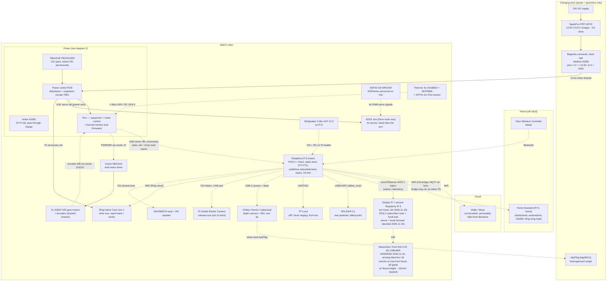
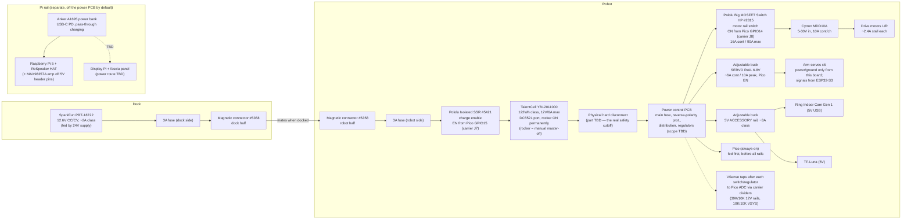
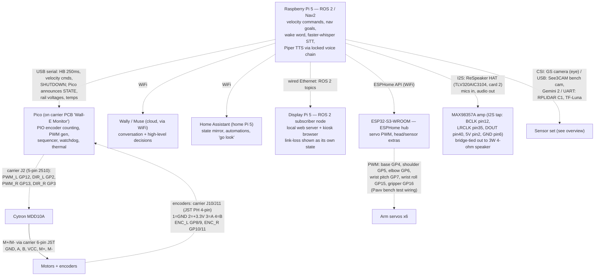

# Wall-E — System Block Diagram

_Created 2026-11-15 (Wally) as Jim's working reference for the full electrical/system
design. Sources: the build plan (`wall-e-robot-plan.md`), the power control PCB notes
(`power-control-pcb-notes.md`), the charging dock build page (`charging-dock-build.md`),
and the carrier netlist verified 2026-11-05. Where a decision is still open, the block
says TBD — nothing here invents a decision._

**How to read:** solid arrows `──►` are power flow. Dashed arrows `┄►` are signal/data.
Diagrams are Mermaid — they render in GitHub, Obsidian, and most Markdown viewers, and
the text stays editable as the design changes.

---

## 1. Whole-system overview

**Reading notes**
- The Pico is the safety root: it owns motor power and the watchdog. No Pi, network,
  or cloud failure can leave the robot driving.
- The dock has **no intelligence** — every charge decision is made on the robot,
  by the sequencer.
- Arm-tip camera is the current recommendation (Gemini 2 on the tip, GS camera
  body-fixed when it arrives, Ring stationary) — Jim's arm-tip proposal is still
  formally undecided; the head-pods layout in the plan is the fallback shape.
- **Display data (decided 2026-11-16):** the display Pi runs ROS 2 (Jazzy) as a
  subscriber-only node on a **wired Ethernet** link to the main Pi — wired, so DDS
  discovery never depends on WiFi multicast. It hosts its own web server and kiosk
  locally and bridges topics to the browser. If topics go silent, the display shows
  link-loss as its own state instead of a frozen page. **MQTT scope (Jim,
  2026-11-16):** not used for the inter-Pi display path — but MQTT is fine for the
  **Home Assistant bridge**, which may run on either Pi. So the Nov 14 room-sensor
  idea stands: current room reaches HA via the MQTT bridge (MQTT discovery).

---

## 2. Power architecture (detail)

**Sequence (Pico-owned, binding on every board):**
battery → Pico live → Pi rail on → Pi heartbeat `HB <counter>` every 250 ms over USB
serial → only then motor rail on. Watchdog 1000 ms; 60 s boot wait is not a fault;
`SHUTDOWN` reverses the order cleanly. Thermal policy: battery/charge-connector hot →
charge path opens; driver/motors/power-distribution hot → motor rail off; bay/body
air hot → warn only.

**Known caveats carried in the design:**
- Pack spec lists both 12V/6A max and 3A max continuous — treat 6A as peak until the
  motors+arm stall test (after delivery) proves otherwise.
- Servo rail is **6.8V, not 7.4V** (MG996R max 7.2V; DS3218/DS3225-class max 6.8V).
- Charge only flows with the pack rocker ON — it stays ON permanently by decision
  (locked 2026-11-15); the SSR, not the rocker, gates charging.

---

## 3. Compute, control and data paths (detail)

**Display data contract (decided 2026-11-16)** — topics the main Pi publishes and
the display Pi subscribes to over the wired Ethernet link:
sequencer state + rail voltages (Pico telemetry, bridged by the main Pi) ·
battery percent, charging/docked state, charge current ·
temperatures (DS18B20 set + MCP9808 + SHT41) ·
nav goal + status, current room/waypoint ·
faults (heartbeat loss, thermal rail shutdowns) — latched on the display until cleared.
MQTT is reserved for the Home Assistant bridge only (either Pi may host it) —
never the inter-Pi display path (Jim, 2026-11-16).

**Pico carrier (Jim's KiCad 'manager' board) — verified netlist pinouts, 2026-11-05**
(the redesign around the motors' 6-pin JST connectors is in progress; these are the
last verified values — re-verify from the new file when it lands)

| Connector | Pins | Carries |
|---|---|---|
| J2 Motor_Driver (5-pin 2510) | 1 GND, 2 PWM_L GP12, 3 DIR_L GP2, 4 PWM_R GP13, 5 DIR_R GP3 | Pico → MDD10A logic (no motor current) |
| Motors (6-pin JST, new) | GND, A, B, VCC, M+, M− | MDD10A outputs in via screw terminals, out to motors; encoders return on A/B |
| J10 / J11 Encoders (JST PH 4-pin) | 1 GND, 2 +3.3V, 3 A, 4 B | ENC_L GP8/9, ENC_R GP10/11 (older separate-connector scheme) |
| J7 Charge_en (JST PH 4-pin) | 1 GND, 2 +3.3V, 3 enable GP15, 4 NC | → SSR #5421 (VIN=pin2, EN=pin3, GND=pin1) |
| J8 Motor_en (JST PH 4-pin) | 1 GND, 2 +3.3V, 3 enable GP14, 4 NC | → #2815 ON pin (uses pins 3+1 only) |
| J4 / J5 I2C (JST PH 4-pin) | 1 GND, 2 +3.3V, 3 SDA GP4, 4 SCL GP5 | MCP9808 (bay), SHT41 (body ambient); 4.7K pull-ups on board |
| J14–J19 Temp (3-pin) | 1 GND, 2 +3.3V, 3 DQ GP6 | 6× DS18B20: battery, MDD10A, motor L, motor R, power distribution, charge connector; 4.7K pull-up at Pico end |
| VSense (J12) | batt_rail, motor_rail (+ VSYS) | Dividers 39K/10K (12V rails), 10K/10K (VSYS), 100nF node caps → Pico ADC |
| J1 Spare IO | GP7, GP16–22, 3.3V, GND | Expansion |

Pico power on the carrier: datasheet-style 5V OR-ing into VSYS (Q1 DMP2035U P-FET);
status LEDs on GP0/1 mirror *measured* state.

---

## 4. Interface list (every wire that crosses a block boundary)

| # | From → To | Type | Connector / medium | Key values |
|---|---|---|---|---|
| 1 | TalentCell → power PCB | Power | DC5521 barrel, centre + | 9–12.6V, 6A max (3A cont caveat) |
| 2 | Power PCB → #2815 → MDD10A | Power | 5mm terminal blocks | Raw battery, motor rail |
| 3 | MDD10A → motors | Power | Carrier screw terminals → 6-pin JST | M+/M− per channel, 10A cont capable |
| 4 | Power PCB → arm servos | Power | 3-pin 2.54mm headers ×6 | 6.8V + GND only (no signals) |
| 5 | Power PCB → Ring cam, TF-Luna | Power | USB-A / pigtail (TBD at layout) | 5V accessory rail, ~3A class |
| 6 | Anker → Pi 5 | Power | USB-C PD | 5V (PD profile; 5A appetite caveat, Witty Pi 5 open) |
| 7 | Dock charger → dock connector | Power | Wire + 3A fuse | 12.6V, ~2A class |
| 8 | Dock ↔ robot connector | Power | Adafruit #5358 magnetic pair | 1+2 = +12.6V, 3+4 = GND, fused both sides |
| 9 | Robot connector → SSR → pack | Power | Wire + 3A fuse | Charge path, Pico-gated |
| 10 | Pico → Pi 5 | Data | USB serial | HB/cmds/state/rail+temp telemetry |
| 11 | Pico → MDD10A | Signal | Carrier J2 | PWM/DIR ×2, 3.3V logic |
| 12 | Encoders → Pico | Signal | 6-pin JST A/B (or J10/J11) | 3.3V only into Pico GPIO |
| 13 | Pico → #2815 / SSR | Signal | Carrier J8 / J7 (JST PH 4-pin) | GP14 / GP15 enables |
| 14 | Pico → DS18B20 bus | Signal | Carrier J14–J19 | 1-Wire DQ GP6, 4.7K pull-up |
| 15 | Pico → MCP9808 / SHT41 | Data | Carrier J4/J5 | I2C GP4/GP5 |
| 16 | ESP32-S3 → arm servos | Signal | GPIO header wiring | 6× PWM (pins in diagram 3) |
| 17 | ESP32-S3 ↔ Pi 5 / HA | Data | WiFi (ESPHome) | Servo cmds, sensor states |
| 18 | Pi 5 → RPLIDAR C1 | Data | USB/UART | sllidar_ros2, 360° scan |
| 19 | Pi 5 → TF-Luna | Data | UART/I2C | 1D range, cliff/dock |
| 20 | Pi 5 → Gemini 2 | Data+power | USB-C | Depth + IMU; 2.5W typ / 7W peak, budget 5V ≥1.5A |
| 21 | Pi 5 → GS camera | Data | CSI ribbon (CAM port) | Service loop through head/arm joint — wear point |
| 22 | Pi 5 → ReSpeaker HAT | Audio | 40-pin header, I2S + I2C | Card 2, TLV320AIC3104 |
| 23 | Pi header → MAX98357A | Audio | I2S tap (pins 12/35/40/2/6) | Bridge-tied speaker out, neither lead is GND |
| 24 | Pi 5 → display Pi | Data | Wired Ethernet (decided 2026-11-16) | ROS 2 topics: sequencer state, rail voltages, temps, battery/dock, nav status, faults; display Pi serves the kiosk UI locally |
| 25 | Display Pi → panel | Video | DSI | 1280×800 (if 7-inch panel; fascia TBD) |
| 26 | Xbox controller → Pi 5 | Data | Bluetooth (xpadneo) | Teleop; A button = voice trigger (remap pending) |
| 27 | Pi 5 ↔ Wally / HA / Ring | Data | WiFi | Cloud brain, HA link, Ring cloud/report-back |

---

## 5. Open / TBD — deliberately not drawn as decided

- **Power PCB rail scope** — which candidate rails live on the board (Jim, 2026-11-14:
  "lets see where it all lands"). Servo rail is the headline; Pi rail stays off-board
  by default.
- **Hard disconnect part** — TBD; this board is its natural home.
- **#2815 mounting** — on the power PCB or off-board, TBD at layout.
- **Battery jack style** on the power PCB — panel DC5521 jack vs cut lead into screw
  terminals, TBD.
- **Servo-rail enable authority** — Pico recommended (one fault authority); not locked.
- **Regulator implementation** — XL4016-class modules vs designed-in converters, rev 1 TBD.
- **Display** — fascia height still unmeasured; the ordered 7-inch panel's fit
  re-opens after that measurement. Display Pi is resolved (second Pi 5, on hand);
  its power route in the robot is still unassigned. Data architecture is DECIDED
  (2026-11-16): ROS 2 subscriber node on wired Ethernet; MQTT reserved for the
  Home Assistant bridge only (either Pi may host it).
- **Witty Pi 5 HAT+** — candidate for true 5V/5A Pi power + managed scheduling; duty
  split with the Pico sequencer open.
- **Dock connector face** — rear/back-in (current lean) vs front/nose-in; decide before
  printing the robot-side mount. Anker dock top-up physical connection also open.
- **Arm, keeper choice** — Pavv is the test mule; RoArm-M2-S is the leading keeper if
  the two-pod head returns; xArm 1S is out for head duty. Arm-tip camera proposal
  (Gemini 2 on tip) undecided.
- **GS camera** — chosen but out of stock everywhere (daily watch running).
- **INA219 (#904)** — optional, only if Pico ADC charge-current read-back isn't clean
  enough for the DOCKED test (voltage + >100 mA for 2 s).

_Sync note: this diagram reflects decisions through 2026-11-16. When a TBD locks,
update the block here and the source note it came from in the same pass._
